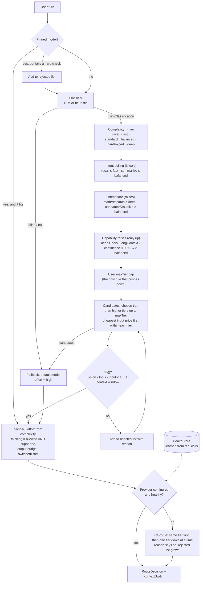

# llm-router

**Picks a model for each chat turn and records why: every decision comes back as an audit record, not a bare model id.**

A cheap LLM classifier reads the turn. A pure, deterministic policy then turns that classification into a model choice: complexity sets the tier, intent applies floors and ceilings, and hard requirements like vision, tools or context length can only push the tier *up*. What you get back is a `RouteDecision` holding the chosen model, the reason in one line, every candidate that was rejected and why, the thinking effort, the output budget, and whether the topic changed since the last turn.

## Why this exists

I extracted this from the chat backend of a production AI learning workspace. That product uses several providers, and the cheapest model that can answer a turn varies a lot from one turn to the next. "Hello" doesn't need a frontier model. A one-line question about a proof does. Hard-coding a model at each call site either burns money or gives bad answers. Users also kept asking *why* a given answer came from a given model, so the routing decision had to be something we could show them, not a log line. The product shows this record under "View activity" on each message.

## How it works



### Design decisions and tradeoffs

- **An LLM classifier plus a pure policy, not embeddings.** A cheap model (the example setup uses Gemini Flash-Lite) fills in a small Zod schema: intent, complexity, domain, needs-tools/vision/long-context, a confidence score and a one-sentence rationale. Everything after that is a plain function with no I/O, no provider SDK and no database. You can unit test the policy line by line, diff it in code review, and change it without touching the chat surface. The cost is one extra small model call per turn, and its latency is recorded on the decision as `classifyMs`.
- **Hard requirements can only push the tier up.** A wrong cheap answer costs more than a right expensive one. Tool use, long context and low classifier confidence all *raise* the tier. Intent floors encode "structurally hard" work: a one-line question about a proof is still a proof. The two things that lower the tier are spelled out: intent ceilings for turns where speed matters most (`recall`, `summarize`), and the user's own `maxTier` cost cap.
- **No silent downgrades.** If no model in the chosen tier fits, the search moves *up* to the next tier, never down. When the router really can't run the chosen tier (for example the provider is out of credit), it steps down one tier at a time and the reason says *"a weaker tier than this turn asked for"*.
- **Unsure means spend more.** If the classifier fails or returns nothing, the turn falls back to the default model and is treated as `hard` for effort. If confidence is below 0.55, the tier is raised to at least `balanced`.
- **The audit record is part of the product.** `rejected[]` lists, in order, every candidate that was skipped and why (`no vision support`, `no tool support`, `context window too small`, `Provider is out of credit`). `switchedFrom` and `isContextSwitch()` tell a real topic change (intent or domain changed *and* the model changed) apart from noise, so the UI can announce real switches and stay quiet about small ones.
- **Provider health comes from real calls, not probes.** Having a key configured doesn't mean a call will succeed. `ProviderHealth` records the outcome of every real call. A recoverable fault (timeout, rate limit) hides the provider for 15 minutes. A terminal fault (no balance, rejected key), or **three failures in a row** whatever the error says, keeps it hidden until a call succeeds or someone clears it by hand. `faultText()` reads the provider's response body as well as the SDK's summary message, because the summary often loses the real cause (a balance error can show up as "Not Found"). Storage sits behind a small `HealthStore` interface. An in-memory implementation is included.
- **The catalog is data.** Policy works in tiers (`fast` / `balanced` / `deep`), not model names, so adding a provider means adding a catalog entry. Within a tier, candidates are sorted by input price. Equal prices keep catalog order.

> **About the bundled catalog:** `EXAMPLE_CATALOG` is a snapshot of model ids, context windows and prices taken when this code was written. **The prices go stale. Don't use them for billing.** Pass your own models to `createCatalog()`.

## Quick start

Needs Node 20+ and pnpm. The demo and tests use a deterministic heuristic classifier, so **no API keys are needed**.

```bash
pnpm install
pnpm demo            # route 8 sample turns and print the audit trail for each
pnpm demo --json     # the same, as full RouteDecision JSON records
pnpm test            # vitest suite
pnpm build           # emit dist/ with type declarations
```

The demo first teaches the health store that one provider is out of credit, then routes a short scripted conversation. Sample output (trimmed):

```text
#2 one-line proof question
  "Prove that the square root of 2 is irrational."
  model       glm-5 (deep)
  mode        auto
  reason      GLM-5 (deep) — math · standard · mathematics
  classified  math · standard · conf 0.80 · mathematics
  needs       none
  effort      medium + thinking · max 32000 out
  switched    from gemini-3.5-flash-lite (topic shift)
  rejected    none

#5 vision
  "What is going on in this photo of my whiteboard notes?"
  model       gemini-3.7-flash (balanced)
  mode        auto
  reason      Gemini 3.7 Flash (balanced) — media · standard
  classified  media · standard · conf 0.80
  needs       vision
  effort      medium + thinking · max 32000 out
  switched    from glm-4.7 (topic shift)
  rejected    glm-4.7 — no vision support

#8 pinned model
  "Anything at all."
  model       gemini-3.7-flash (balanced)
  mode        fallback
  reason      Claude Sonnet 5 is out of credit; using Gemini 3.7 Flash.
  classified  — (no classification)
  needs       —
  effort      high + thinking · max 32000 out
  switched    from gemini-3.5-flash-lite (topic shift)
  rejected    claude-sonnet-5 — Provider is out of credit
```

In turn #2 the classifier rated the question `standard`, and the `math` intent floor raised it to `deep`. In turn #5 the cheapest balanced model has no vision support, so it was rejected and the router recorded why. In turn #8 the user pinned a model whose provider is out of credit, so the router announced the switch in the reason instead of failing the call or overriding the pin silently.

### Using it as a library

```ts
import { AiSdkClassifier, ProviderHealth, Router, RoutingPreference, faultText } from 'llm-router';
import { google } from '@ai-sdk/google'; // any Vercel AI SDK provider

const health = new ProviderHealth(); // or new ProviderHealth({ store: yourDbBackedStore })
const router = new Router({
  classifier: new AiSdkClassifier(google('gemini-3.5-flash-lite')),
  health,
  configuredProviders: ['google', 'anthropic', 'openai'],
});

const { decision, contextSwitch } = await router.routeTurn({
  turn: { prompt, recentTurns, attachedContext: [], workspaceKind: null },
  preference: RoutingPreference.parse({ maxTier: 'deep' }),
  previous: lastDecision,
  estimatedInputTokens,
});

// ...call decision.modelId, then teach the health store what happened:
await health.record({ provider, ok: true });
// or, on failure: await health.record({ provider, ok: false, message: faultText(error) });
```

You can swap in your own classifier by implementing `Classifier.classify()`. It must never throw: return `classification: null` with an `error` and the policy will fall back to the default model and spend more. `HeuristicClassifier` (keyword rules) and `FixedClassifier` are included for tests and demos. They aren't meant to replace the LLM.

## Tests

```bash
pnpm test        # 160 tests
pnpm coverage    # v8 coverage report
```

The original code had no tests. What this suite proves:

- **Policy (`test/policy.test.ts`):** every complexity→tier mapping. Every intent floor and ceiling, and that floors never lower and ceilings never raise. Each capability raise (tools, long context, confidence below the threshold, exactly at the threshold) and that raises can't lower a `deep` turn. That `maxTier` overrides both floors and raises. Rejected-candidate reasons and their order for vision, tools and context, with the 1.3× headroom tested at its exact edge. The upward tier search versus the no-fit fallback. Pinned models: one that fits, one that fails a check, one with no classification, an unknown id, and pinned mode with no id. Unclassified turns. Missing-default errors. Effort, thinking and output-budget sizing. Reason formatting. `switchedFrom`. Schema validity of every decision. Determinism: identical input gives an identical decision, and inputs aren't mutated. Every `isContextSwitch` branch.
- **Health (`test/health.test.ts`):** cooldown at the boundary (just before and exactly at 15 min). Custom cooldowns. Each new failure restarting the cooldown. Three strikes turning a provider terminal, and terminal providers never ageing out. Terminal messages being terminal on the first failure. Recovery on success (and that the failure count really resets). Clearing a provider by hand. `faultText` reading the response body, data, status code and cause chain, including circular data and a cause that points back at itself. The full fault-classification table.
- **Availability, classifiers and router:** re-routing around unhealthy versus unconfigured providers, the one-tier-at-a-time downgrade and its wording, and `switchedFrom` recomputed after re-routing. `AiSdkClassifier` run against the AI SDK's `MockLanguageModelV4`: structured output parses, and schema violations and provider errors come back as `null` instead of throwing. Classifier prompt construction and truncation. Heuristic classifier rules. The end-to-end `Router`.

Coverage is 100% of lines and statements. Branch coverage is 99%. The one uncovered branch in `policy.ts` is a `?? 'unavailable'` default that can't be reached, because a pinned model that passes every check has already returned by that point.

## What was left out

The real system wraps this in a database backend: an agent action loads the conversation, stores each decision on the message, streams the answer, retries across providers, and writes health rows through database mutations. All of that is product-specific and isn't here. Also left out: the provider client factory (API-key lookup and OpenAI-compatible base URLs), the custom client for one provider that loses its own error bodies, the logging and error-code layer, and the agent persona and tool allow-lists that the classified intent selects. `HealthStore` replaces the database table, and `rerouteAroundUnavailable()` is the provider-availability step lifted out of the agent action as a pure function.
